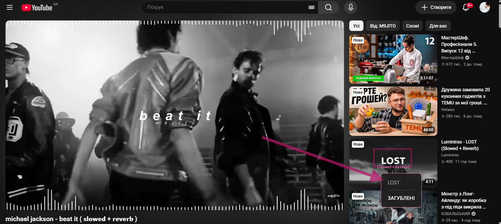
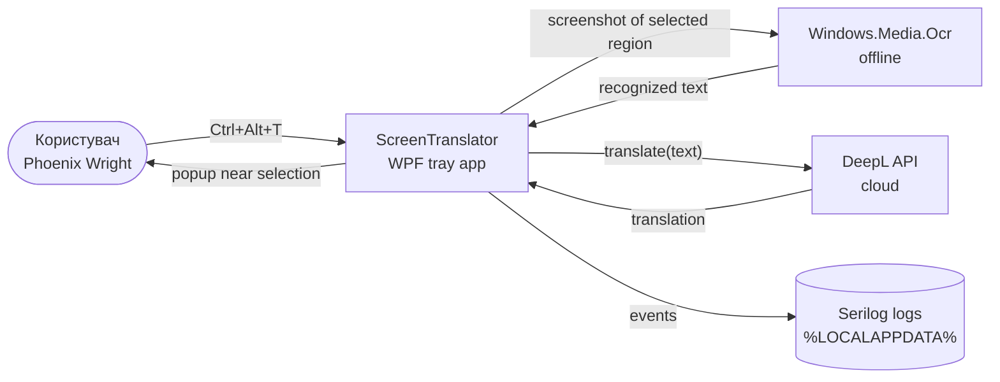
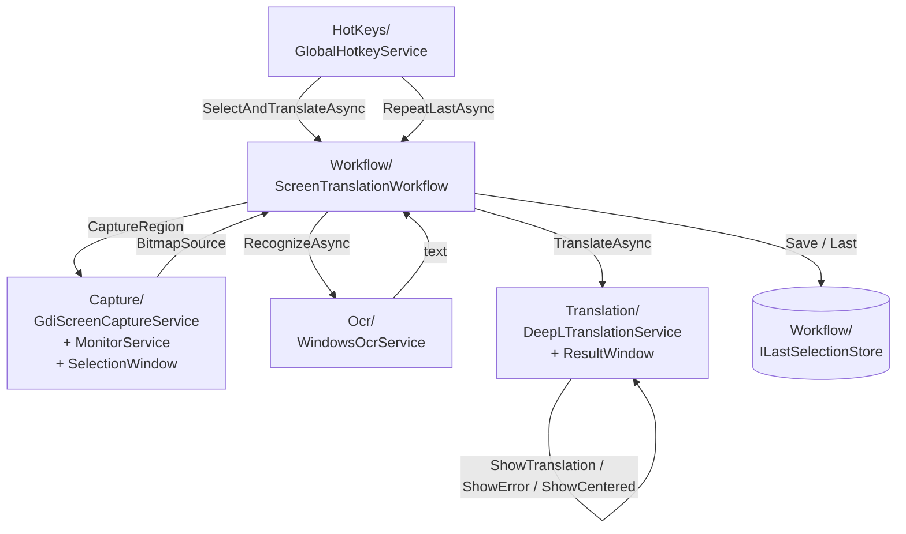

# ScreenTranslator

Десктопний застосунок для Windows: виділяєш область на екрані гарячою клавішею, і переклад випливає у маленькому вікні поверх гри — без втрати фокусу, без згортання.



## Що робить

Пайплайн: hotkey → знімок монітора → виділення області на замороженому кадрі → OCR → переклад → невелике вікно з результатом поряд із виділенням. Застосунок живе в треї, окремо нічого не блокує.

## Features

- Глобальна гаряча клавіша (`Ctrl+Alt+T` за замовчуванням) працює навіть з фокусом у грі.
- **Заморожений кадр при виділенні** — текст у грі не змінюється, доки малюєш прямокутник.
- Повторити останню область (`Ctrl+Alt+R`) — без вікна виділення, одразу переклад тієї ж координати.
- Вікно результату не забирає фокус у гри, не ставить її на паузу.
- Коректно на моніторах з масштабуванням 125–150%.
- Файлове логування у `%LOCALAPPDATA%\ScreenTranslator\logs\`.
- Обробка помилок: порожній OCR, невалідний ключ DeepL, вичерпаний ліміт, нема інтернету — зрозуміле повідомлення, застосунок живий.
- Конфігурованість через `appsettings.json`: хоткеї, мова OCR, цільова мова перекладу, час авто-зникнення вікна, розмір шрифту.

## Tech stack

- **.NET 10 + WPF**.
- **Generic Host** (`Microsoft.Extensions.Hosting`).
- **Windows.Media.Ocr**.
- **DeepL.net** SDK.
- **Serilog**.
- **H.NotifyIcon.Wpf**.
- **Win32 P/Invoke** через `LibraryImport`.

## How to run

### Prerequisites

- Windows 10 версія 2004 (build 19041) або новіша; Windows 11 підтримується.
- .NET 10 SDK: `dotnet --list-sdks` *(тільки для build-from-source; installer self-contained, рантайм уже всередині)*.
- Встановлений **OCR language pack** для потрібної мови:
  ```powershell
  Add-WindowsCapability -Online -Name 'Language.OCR~~~en-US~0.0.1.0'
  ```
  Перевірка встановлених: `Get-WindowsCapability -Online | Where-Object Name -like 'Language.OCR*'`
- Безкоштовний API-ключ DeepL (https://www.deepl.com/pro-api).

### Install (pre-built installer)

Якщо є скомпільований `installer/output/ScreenTranslator_Setup.exe` *(якщо ще немає — див. [«Build the installer»](#build-the-installer) нижче)*:

- Запусти його — per-user встановлення в `%LOCALAPPDATA%\Programs\ScreenTranslator\`, без UAC.
- Опційні чекбокси при встановленні: ярлик на робочому столі, запуск при старті Windows.
- Перед першим використанням виставити `SCREENTRANSLATOR_DEEPL_API_KEY` (крок 2 нижче).
- Деінсталяція — через «Програми й компоненти» як для будь-якого Windows-застосунку.

Інсталятор збирається через Inno Setup з `installer/ScreenTranslator.iss` — див. [`docs/notes/inno-setup.md`](docs/notes/inno-setup.md).

### Build from source (for developers)

1. Клонувати і відкрити рішення:
   ```powershell
   git clone <this-repo>
   cd ScreenTranslation
   ```
2. Виставити API-ключ DeepL у змінну середовища користувача (**ключ не живе в репо**):
   ```powershell
   [System.Environment]::SetEnvironmentVariable('SCREENTRANSLATOR_DEEPL_API_KEY', '<your-key>', 'User')
   ```
   Після цього перелогінитися або перезапустити термінал.
3. Опційно скорегувати `src/ScreenTranslator/appsettings.json`:
   ```json
   {
     "HotKeys":       { "Select": "Ctrl+Alt+T", "RepeatLast": "Ctrl+Alt+R" },
     "Ocr":           { "Language": "en-US" },
     "Translation":   { "TargetLang": "UK", "SourceLang": null },
     "ResultWindow":  { "AutoHideSeconds": 10, "FontSize": 16 }
   }
   ```
   `Ocr.Language` — BCP-47 (en-US, uk-UA, ja-JP). `Translation.TargetLang` — ISO 639-1 (UK, EN, DE…).

### Build & Run

```powershell
dotnet build src/ScreenTranslator/ScreenTranslator.csproj
dotnet run --project src/ScreenTranslator/ScreenTranslator.csproj
```

Або `F5` у Visual Studio / Rider.

Після старту — іконка в треї, застосунок чекає на задіяння гарячих клавіш. Правий клік по іконці → «Закрити» для виходу.

### Build the installer

1. Збудувати self-contained single-file exe:
   ```powershell
   dotnet publish -c Release
   ```
   Результат — у `src/ScreenTranslator/bin/Release/net10.0-windows10.0.19041.0/win-x64/publish/`.
2. Відкрити `installer/ScreenTranslator.iss` в Inno Setup Compiler → **Build → Compile** (F9).
3. Готовий інсталятор — `installer/output/ScreenTranslator_Setup.exe`).

Деталі синтаксису `.iss` — у [`docs/notes/inno-setup.md`](docs/notes/inno-setup.md). Деталі налаштувань публікації (self-contained, single-file, RID) — у [`docs/notes/release-publishing.md`](docs/notes/release-publishing.md).

### Для гри

Запусти гру у **борлес-віконному** режимі (Phoenix Wright, манхва-рідер, будь-що). Fullscreen-exclusive заважає overlay'у — там Windows не покаже наше вікно поверх.

## Project structure

Feature-based (vertical slice) організація: кожна папка — одна технічна здатність, усе необхідне всередині, між папками — тонкі контракти через інтерфейси.

```
src/ScreenTranslator/
├── App.xaml.cs           # composition root: читає env, збирає DI, реєструє хоткеї
├── HotKeys/              # глобальні хоткеї (RegisterHotKey)
├── Capture/              # знімок монітора + вікно виділення на замороженому кадрі
├── Ocr/                  # Windows.Media.Ocr
├── Translation/          # DeepL SDK + ResultWindow (UI показу)
├── Workflow/             # координатор pipeline-у + ILastSelectionStore
├── Configuration/        # IOptions<T> POCO (HotkeyOptions, OcrOptions, …)
├── Logging/              # Serilog file logging setup
└── Styles/               # ResourceDictionary (AccentBrush, AccentFaintBrush)
```

### System context



### Pipeline (internal)


